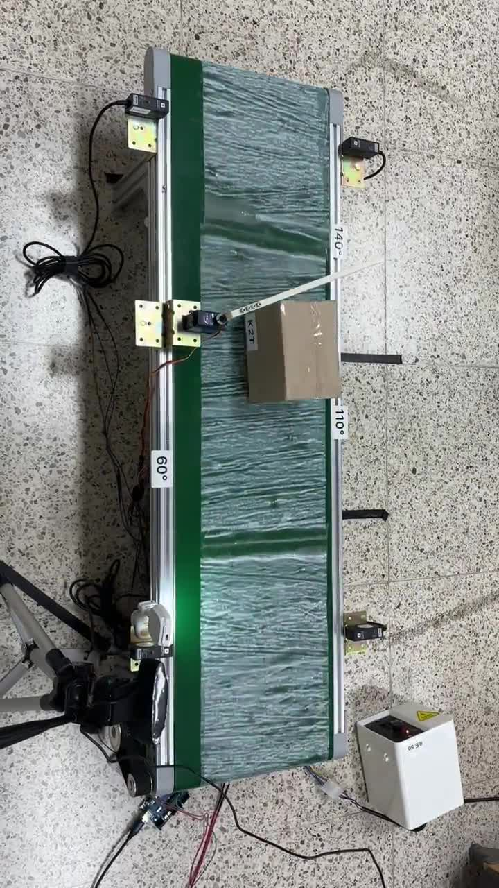
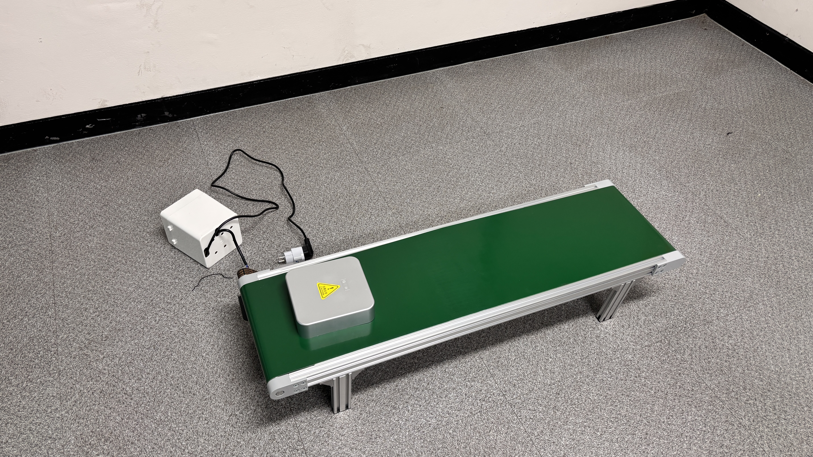
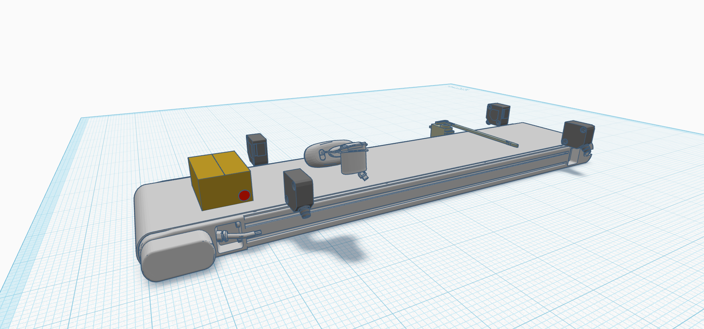
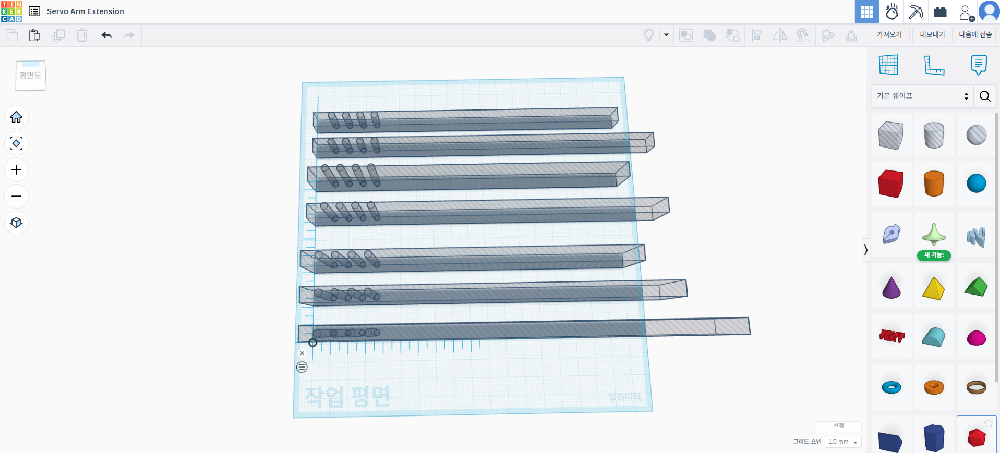
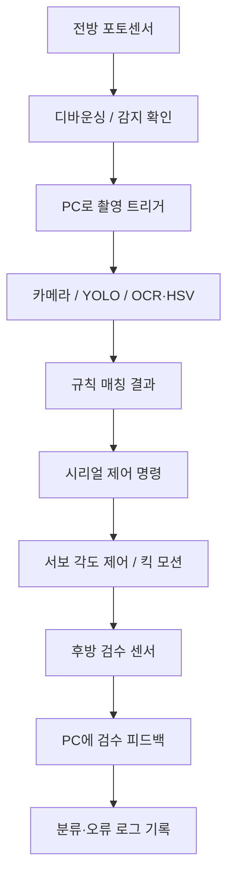

# 🤖 SmartParcel Arduino — 센서·서보 제어 및 물리 분기

> **SmartParcel Embedded Control Module** · Arduino Uno R3  
> 센서 감지 → 이미지 캡처 트리거 → 시리얼 명령 수신 → 서보모터 분기 → 후방 검수로 이어지는 자동 분류 하드웨어 제어

[통합 프로젝트](https://github.com/yoniyon03/smart-sort) · [AI 비전](https://github.com/yoniyon03/smart-sort-ai) · [웹 대시보드](https://github.com/yoniyon03/smart-sort-web)

---

## 🏗 Hardware Prototype

| 제작 과정 실물 | 3D 전체 모델 |
| :---: | :---: |
|  |  |

### Servo Horn Customization

분류 대상 물체의 **마찰·크기**와 서보혼 길이 한계로 인해 분기 동작이 불안정해지는 문제에 대응해, 커스텀 서보혼의 구조를 검토하고 **킥 모션 제어**를 적용했습니다.

---

## 🛠 Tech Stack & Components

   

| 구성품 | 최종보고서 기준 |
| --- | --- |
| MCU | Arduino Uno R3 |
| 컨베이어 | 1m × 25cm, 60W, 속도비 1:6 (최종보고서) |
| 감지 센서 | Autonics BM3M-TDT 투과형 포토센서 (전방 감지·후방 검수) |
| 모터 | RC920DMG 고토크 서보모터, 0~180° 제어 |
| 영상 | Logitech C922 USB 카메라 |
| 센서 전원 | 12V 계열 외부 전원/배터리 구성 |
| 서보 전원 | 6V 계열 외부 전원/배터리 구성 |
| 인터페이스 | PC–Arduino USB/UART 시리얼 통신 |

> 전원·배선은 반드시 실제 회로도와 개별 장비의 정격 사양을 기준으로 점검해야 합니다. 이 문서는 **완제품 배선 지침이나 핀맵을 대신하지 않습니다.**

---

## 🔄 Control Flow

### 주요 제어 기능

- **센서 신호 안정화:** 포토센서 입력 이벤트에 대한 디바운싱 및 중복 감지 억제
- **독립 상태 관리:** 전방 물체 감지와 후방 분류 검수 센서의 상태를 분리해 추적
- **시리얼 명령 처리:** Python 제어 프로세스와의 양방향 통신·상태 피드백
- **서보 분기:** 매핑된 슈트 각도에 따라 구동, HOME 복귀 및 킥 모션 제어
- **예외 피드백:** 검수 실패·센서 이상·모터 동작 오류 등을 PC 측에 전달할 수 있도록 연동 구조 설계

---

## 📡 Serial Communication

최종 결과보고서의 **팀원 포트폴리오에 명시된 프로토콜 예시**입니다.

| 예시 메시지 | 의미 |
| --- | --- |
| `0` / `1` | 센서 상태 이벤트 예시 |
| `CHECK_0` / `CHECK_1` | 후방 검수 상태 예시 |
| `SERVO 90` | 지정 각도로 서보 제어하는 명령 예시 |
| `HOME` | 서보 기본 위치 복귀 |
| `PING` / `PONG` | 통신 상태 확인 |

> 위 메시지는 **최종보고서에 기록된 프로토콜 예시**입니다. 전체 명령 목록·종결 문자·baud rate·응답 타이밍은 실제 `.ino` 코드 정의를 기준으로 합니다.

---

## 🔧 Engineering Challenges

**1. 산업용 센서와 MCU 연동:** 센서 출력 방식, 전원 전압, 신호 노이즈를 검토하고 안전한 회로 구성과 감지 신호 안정화에 집중했습니다.

**2. 전원 문제:** 개발 중 전압 강하, 역전류 및 연결 실수로 보드가 손상되는 시행착오를 경험했고, 전원부·배선·보호 대책과 안정성 테스트를 개선했습니다.

**3. 분기 타이밍:** 컨베이어 속도, 대상 물체의 마찰, 서보 토크·가동 범위 및 촬영/AI 처리 시간을 함께 고려했습니다.

**4. 검수 피드백:** 감지 신호만으로 성공을 가정하지 않고, 후방 센서를 통해 실제 분류 여부를 확인하는 구조를 적용했습니다.

---

## 📊 System-wide Validation

최종보고서의 **통합 시스템 시험**에서 300회 중 287회의 분류가 지정된 슈트로 정상 분기되어 성공률 **95.7%**를 기록했습니다. 이는 Arduino 코드 단독 시험 결과가 아니라 **AI·서버·센서·서보를 포함한 End-to-End 결과**입니다.

---

## 👤 My Contributions — 장세연

- 컨베이어·포토센서·서보모터·카메라 및 전원/배선 시스템의 선정·설계·조립
- Arduino C++ 기반 센서 감지, 디바운싱, 검수 입력, PWM 서보 제어 로직 개발
- Python–Arduino 양방향 Serial 명령 구조 정의 및 통합 동작 시험
- 서보혼 3D 모델 설계·제작 및 물리 분기 기구 개선
- 센서–카메라–AI–서보 제어의 타이밍/오류 흐름을 시스템 수준에서 설계

---

## 🚀 Build & Wiring Notes

재현 가능한 개발 환경을 위해 다음 정보를 실제 Arduino 스케치 및 회로 구성과 일치하도록 문서화해야 합니다.

1. Arduino IDE 및 보드/포트 선택, 라이브러리 의존성
2. 핀맵(감지·검수 센서 입력, PWM 출력)과 회로 이미지
3. 외부 전원/공통 GND 및 신호 레벨 조건
4. Serial baud rate, 줄바꿈 규칙, 명령/응답 예시
5. 센서 감도·디바운싱·서보 각도/홈값·킥 모션 상수
6. AI 서버 없이 시험 가능한 안전한 서보 테스트 방법

> 센서나 외부 서보 전원 배선을 변경할 때에는 전원을 끄고 정격/전압을 확인하세요. Arduino 신호핀에 산업용 센서 전압을 직접 인가하지 마세요.
